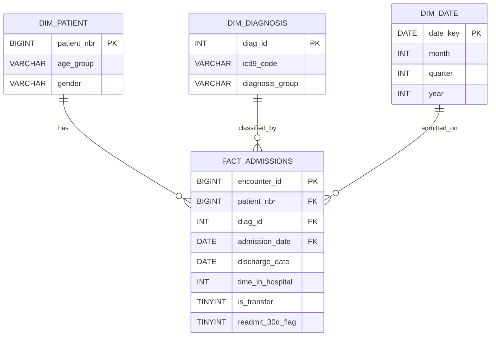

# Patient Readmission Analysis (30-Day Healthcare Analytics Pipeline)

[](https://www.python.org/)
[](https://www.mysql.com/)
[](https://powerbi.microsoft.com/)
[]()

> **HCL Data Analyst Capstone — Project #16**  
> **Author:** Swati Kashyap (`2025B15410251`)  
> **Dataset:** Diabetes 130-US Hospitals for Years 1999–2008 (Kaggle / UCI)

---

## 1. Problem Statement
Unplanned hospital readmissions within 30 days of discharge are a primary indicator of care quality and avoidable healthcare expenditure. This project implements an end-to-end analytics pipeline across **Python**, **Relational SQL (Oracle SQL / MySQL 8.0)**, and **Power BI** to:
1. Clean raw clinical encounter records and handle edge cases (**missing patient IDs, expired patients, inter-facility transfers, and multi-visit histories**).
2. Compute and cross-verify **30-day unplanned readmission flags** using both chronological windowing in Pandas and correlated **30-day self-joins** in SQL.
3. Deliver an executive **Power BI dashboard** tracking readmission risk across age cohorts and primary diagnosis groups.

---

## 2. Executive KPI Summary (Verified Results)

| KPI Metric | Verified Value | Definition / Notes |
| :--- | :---: | :--- |
| **Raw Encounters Loaded** | `101,766` | Source baseline (`diabetic_data.csv`) |
| **Expired Dispositions Removed** | `1,652` | Excluded (`discharge_disposition_id IN (11, 19, 20, 21)`) |
| **Clean Eligible Encounters** | `100,114` | Validated denominator exported to `clean_admissions.csv` |
| **Facility Transfers Isolated** | `18,081` (`18.06%`) | Flagged (`is_transfer = 1`, IDs `2, 3, 4, 5`), excluded from unplanned returns |
| **30-Day Unplanned Readmissions** | `4,067` | Non-transfer return visits within `1–30` days of discharge |
| **Overall 30-Day Readmission Rate** | **`4.06%`** | Reconciled identically across Python and Power BI |

---

## 3. Data Model (Star Schema)



---

## 4. Cohort Analytics Findings

### Readmission Rate by Primary Diagnosis
| Diagnosis Group | Total Admissions | 30-Day Readmissions | 30-Day Readmission Rate |
| :--- | :---: | :---: | :---: |
| **Diabetes** | 8,693 | 547 | **6.29%** |
| **Digestive** | 9,183 | 426 | **4.64%** |
| **Respiratory** | 10,091 | 457 | **4.53%** |
| **Circulatory** | 29,834 | 1,148 | **3.85%** |
| **Other** | 42,313 | 1,489 | **3.52%** |

### Readmission Rate by Age Group
| Age Group | Total Admissions | 30-Day Readmissions | 30-Day Readmission Rate |
| :--- | :---: | :---: | :---: |
| **[20–30)** | 1,650 | 152 | **9.21%** |
| **[30–40)** | 3,765 | 223 | **5.92%** |
| **[40–50)** | 9,626 | 504 | **5.24%** |
| **[60–70)** | 22,185 | 914 | **4.12%** |
| **[50–60)** | 17,102 | 697 | **4.08%** |
| **[70–80)** | 25,562 | 942 | **3.69%** |
| **[80–90)** | 16,706 | 549 | **3.29%** |
| **[90–100)** | 2,668 | 71 | **2.66%** |
| **[10–20)** | 690 | 15 | **2.17%** |
| **[0–10)** | 160 | 0 | **0.00%** |

---

## 5. Key Clinical Insights & Recommendations
* **Rate vs. Volume Split by Age:** Young adults aged **[20–30)** carry the highest 30-day readmission rate (**9.21%**), whereas seniors aged **[70–80)** and **[60–70)** generate the largest absolute readmission volume (**942** and **914** cases). Hospitals should combine targeted glycemic adherence outreach for younger adults with structured 7-day post-discharge follow-up calls for seniors.
* **Primary Diagnosis Risk Concentration:** Primary **Diabetes** admissions record a **6.29%** readmission rate—nearly **1.6×** higher than Circulatory (**3.85%**). Prioritizing pre-discharge medication reconciliation for Diabetes discharges delivers the highest impact.
* **Edge-Case Integrity:** Excluding **1,652** expired encounters and isolating **18,081** inter-facility transfers prevents artificial inflation of unplanned readmission metrics.

---

## 6. SQL Self-Join & 20-Patient Verification
* Implemented `vw_readmission_30d` (correlated 30-day self-join checking `DATEDIFF(b.admission_date, a.discharge_date) BETWEEN 1 AND 30` with `is_transfer = 0`) and `vw_readmission_summary`.
* Executed in **MySQL 8.0 Command Line Client** (Oracle SQL compatible script also included), returning 18 aggregated cohorts in `0.01 sec`.
* Exported `verify_20_patients.csv` (20 multi-visit patients covering `<30d`, `>30d`, transfer, and final-encounter scenarios) and confirmed **100% agreement** between manual date arithmetic, Python flags, and SQL flags.

---

## 7. Repository Structure
```text
HCL-DA-PROJECT/
├── clean_readmissions.ipynb                      # Python data cleaning, edge-case handling & EDA
├── oracle_readmission.sql                        # Table DDL, 30-day self-join view & KPI summary view
├── readmission_dashboard.pbix                    # Interactive Power BI Desktop dashboard
├── verify_20_patients.csv                        # 20-patient manual & SQL audit verification dataset
├── Patient_Readmission_Analysis_HCL_Report.docx  # Final executive project report
└── README.md                                     # Project documentation & Star Schema
```

---

## 8. How to Reproduce
1. **Python (Kaggle / Local):** Run `clean_readmissions.ipynb` against `diabetic_data.csv` to generate `clean_admissions.csv`, `verify_20_patients.csv`, and `oracle_inserts.sql`.
2. **SQL (Oracle / MySQL 8.0):** Execute the DDL and views in `oracle_readmission.sql`, load `oracle_inserts.sql`, and run `SELECT * FROM vw_readmission_summary;`.
3. **Power BI Desktop:** Open `readmission_dashboard.pbix` and point the data source to `clean_admissions.csv` to refresh all DAX measures and visuals.
